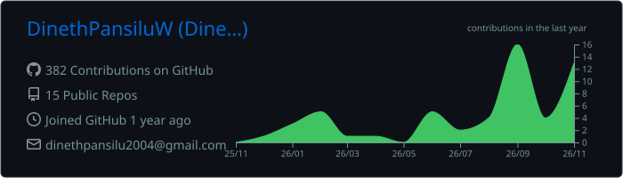
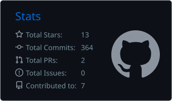
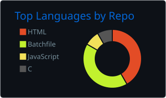
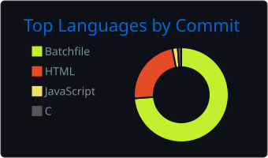

  

  
  
  
  
  
  
  

---

## 👨‍💻 About Me

I'm a **Computer Science undergraduate** pursuing a **BCS degree at the University of Ruhuna, Sri Lanka 🇱🇰**. I enjoy turning ideas into clean, responsive and user-friendly web applications, and I'm always looking for ways to grow as a software engineer.

- 🎓 **Studying:** Bachelor of Computer Science (BCS), University of Ruhuna
- 🔭 **Currently working on:** Improving my frontend development skills and building full-stack projects
- 🌱 **Currently learning:** Modern JavaScript, React, Git workflows, data structures & algorithms
- 🤝 **Open to:** Internships, collaborations and open-source contributions
- 💬 **Ask me about:** HTML, CSS, JavaScript, PHP, MySQL, C
- ⚡ **Fun fact:** I love watching movies and exploring new technologies!

---

## 🛠️ Tech Stack

**Languages & Web**

  

**Databases, Tools & Design**

  

**Currently Learning**

  

---

## 📊 GitHub Stats

---

## 🤝 Let's Connect

I'm always happy to chat about web development, university projects or tech in general. Reach me on **WhatsApp**, **LinkedIn**, **Telegram** or at **dinethpansilu2004@gmail.com**.

⭐ **Thanks for visiting my profile!** 🚀

